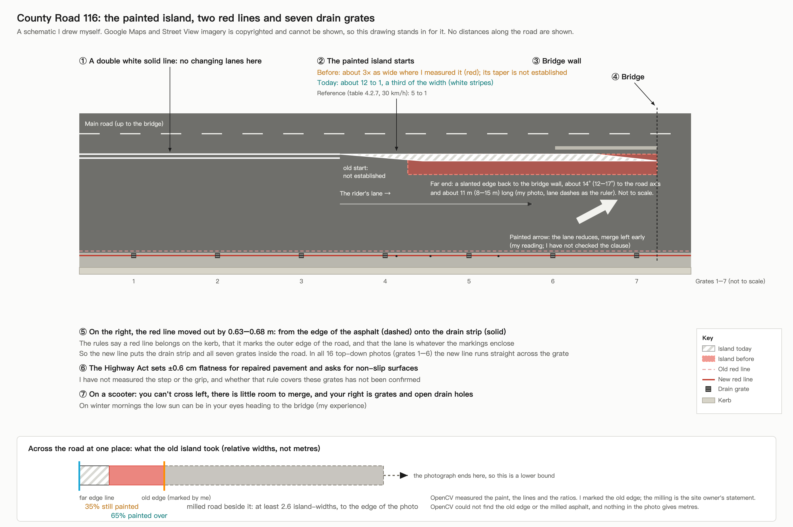
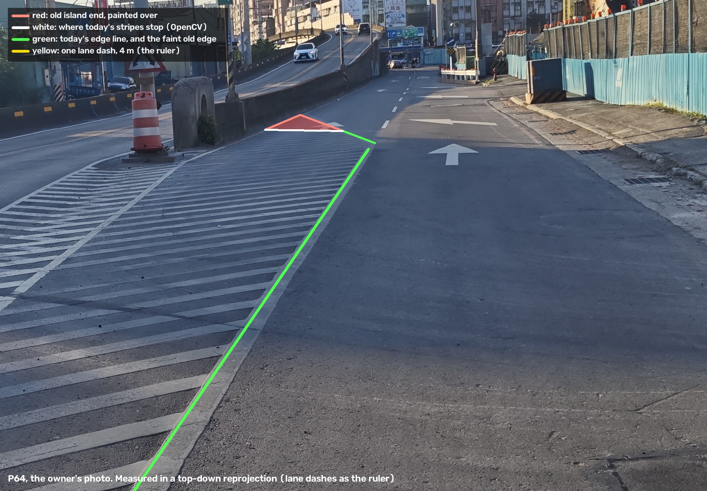
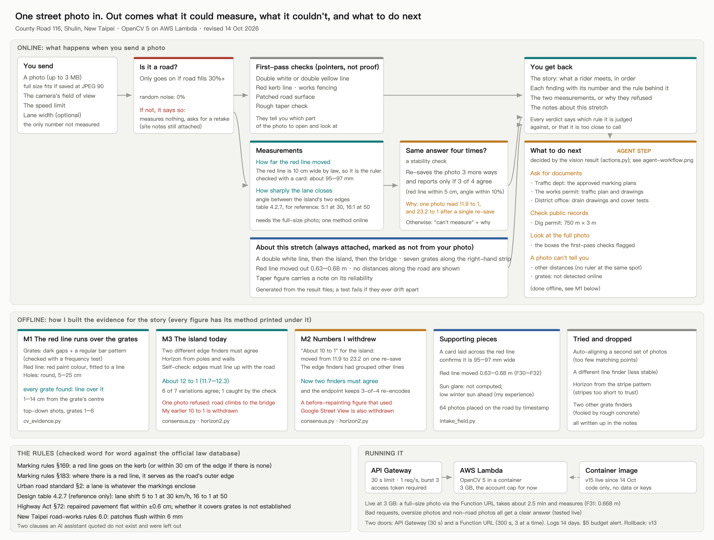

# Seven drain grates on County Road 116

*A rider, a phone, and OpenCV 5 against one stretch of road in New Taipei.*

**Video:** https://youtu.be/UkINgvk1z-E



## The road

I ride County Road 116 in Shulin every day. Just before it climbs onto a bridge, the lane I'm in gets squeezed.

First a double white line says I can't change lanes. Then a painted island narrows the lane from the left. On my right, the whole way, there's a drain strip with seven steel grates set into it.

Before the island was repainted, I had to move over in a hurry. After it, the rush was gone, but the asphalt beside the drain strip had been dug up and patched, and at night I'd find myself riding over those seven grates, one after another.

Nothing here is obviously illegal. That's the problem. Every piece sits right at the edge of what's allowed, and they all land on the same stretch and the same person.

This project turns that feeling into numbers anyone can check.

## What the photos show

**The red line moved onto the drains.** There are two red no-stopping lines. The old one runs along the edge of the asphalt. The new one is painted 0.63–0.68 m further out, on the concrete drain strip, straight across the grates. Taiwan's marking rules say a red line belongs on the kerb (§169), that it marks the outer edge of the road (§183), and that a lane is whatever the markings enclose (Urban Road Standard §2). So the new line puts the drains inside the road.


In all 16 top-down photos (grates 1–6; grate 7 has no top-down photo), OpenCV finds the new red line's axis running across the grate, 1.0–14.3 cm from its centre (`results/grate_crossings_2026-09-23.json`). That result needs no scale at all.

**The ruler is the line itself.** A red line is 10 cm wide by law. A card of standard ID-1 size (85.60 mm) laid across the freshly painted line, measured automatically on P55 and P56 (P59's reading failed; `isolation/field-2026-09-23/card_vs_redline.json`), gives 95–97 mm: close enough to use the line as the ruler. The shift is the median gap from the new line's inner edge to the old line's centre, 0.63–0.68 m on three photos, using the legal 10 cm. If the line is really about 96 mm wide, every gap is about 4% smaller (about 0.61–0.65 m).

**Seen from above, the island opens at a steep angle, and its old end was painted over.** Standing on the road you cannot compare these: the far end is squeezed into a sliver. So OpenCV turns my photo P64 into a top-down view, with the lane line's own dashes (4 m each, §182) as the ruler, and measures there (`scripts/erased_triangle.py`, `results/erased_triangle_P64.json`):

- **The shape.** The island's lane-side edge runs straight along my lane. Its other edge opens towards the main road at about 9° (8.5–9.4°), about 6 to 1, until the cone where the bridge wall begins. Elsewhere on the island, in photo F40, two independent line finders read about 12 to 1, so it opens more steeply near the cone. Taiwan's urban road design table asks for at least 5 to 1 at 30 km/h for a through-lane shift; that table is written for lane shifts at turning lanes, so I use it only as a reference.
- **The old end.** Past the cone the stripes run on beside the bridge wall and stop. Beyond them, a triangle of the old island was painted over: about 8.5 m along the wall, 2.1 m wide at its base, about 9 m². Its old slanted edge, at about 14° to the road, is still faintly visible: it reads 12 on a brightness scale where today's edge line reads 30. The left lane's straight-ahead arrow is now painted on top of it.
- **Who did what.** OpenCV made the top-down view, found the edge line and a lane dash (4.1 m, which checks the ruler), found where today's stripes stop from the share of white paint, measured the opening angle with a line finder, and computed the triangle and drew it back on the photo. I gave the dash centres, the two ends of the old edge and the line its tip reaches (which sets the triangle's length and area), and I read the faint diagonal as the old edge. Within about ±10%.



**What it means on a scooter: the risk is after the merge.** Past the island the road has two lanes, and the right one has a painted arrow I read as "merge left" (I have not checked the clause). So everyone ends up in the left lane. Measured the same way, in P64's top-down view, that lane is about 3.1 m wide (3.13 m, ±10%) between the wall-side line and the lane line.

- **Side by side.** A typical car (1.78 m), 0.5 m of clearance and a scooter (0.75 m) need 3.03 m. That is a sum I made, using the 0.5 m of Road Traffic Safety Rules §101; it is not a lane-width rule. It leaves about 0.1 m, which is inside the measurement's error. With a bus or truck (2.5 m) it is about 0.6 m short (`results/erased_triangle_P64.json`, the needs from `results/width_budget.json`).
- **No escape to the right.** Before the merge, the right lane is about 4.05 m to the edge of the asphalt. Beyond that is the drain strip: the new red line runs over the grates, with open drain holes beside them, so it is not a place to ride.
- **The lane reduction itself.** The right lane's arrow says to merge left, after the island. During the works the limit was about 30 km/h (my observation). Against the 30 km/h reference, the island's opening (about 6 to 1) is just inside 5 to 1, so I am not calling the paint non-compliant. The squeeze is in what comes after it: in my experience, scooters and cars compete for one lane.
- **Rain and night.** In rain, with poor visibility, or at night, all of this gets worse: the grates and paint are slippery when wet (not measured), and the lane lines are harder to see. As a reference, the literature allows 2.5 s to perceive and react, and asks for at least 3.65 s of preview at night (`docs/evidence.md` M5). That is my experience as a rider plus published reference values, not a measurement of this site.

**The island was also wider before the paint-over, where I measured it.** From another photograph of mine (F17) and one mark I drew by hand (OpenCV cannot find that old edge): about two thirds of the island's width was painted over there. I did not find the same share everywhere, so I do not give an old taper. What OpenCV did and what it could not do is in `docs/technical-report.md` section 4.4.

**My first number was wrong, and I withdrew it.** I originally published 10 to 1. When I drew the lines the program had actually picked, they weren't the island's two edges at all, and re-saving the photo once turned 11.9 into 23.2. In the offline analysis two independent edge finders now have to agree. The online endpoint still runs the older single-method taper check, and every online measurement is re-run on four versions of the image and reported only if at least three of them measure and agree.


**The rest of the stack.** On winter mornings the low sun can sit in your eyes heading for the bridge (my experience; the hours I had computed used a road bearing read from Street View, so I don't give them). The Highway Act (§72) sets a flatness tolerance for repaired pavement (±0.6 cm on a 3 m straightedge) and asks for non-slip surfaces; whether that applies to these covers is not established. I haven't measured either the step or the grip. That's written down as a gap, not claimed.

The full story, with a source for every number: [`docs/story-116.md`](docs/story-116.md). Every figure made by image recognition has its method printed underneath and is indexed in [`docs/materials-2026-09-23.md`](docs/materials-2026-09-23.md).

## What the system does



The decision step (perceive, decide, act) is drawn separately, with a trace and a 20-photo evaluation, in [`docs/figures/agent-workflow.png`](docs/figures/agent-workflow.png) and section 8 of the technical report.

Send one street photo. It checks the photo actually shows a road, runs its measurements, and only reports a number if at least three of four re-encoded versions of the image measure it and agree. It tells you what it measured, what it couldn't, and why. Then it tells you what to do next: which document to request from which office, tied to what it found in your photo. That step is `src/marking/actions.py`: a document request appears only when something in your photo calls for it, and it says what that was.

**When it refuses, it goes and gets more evidence.** A phone takes a burst, so a refusal is not the end. If the red-line gap is refused on the photo sent but the red-line pair was seen, or if it was measured and can be confirmed, the system finds the photos taken within 3 seconds of it (from the evidence MANIFEST's capture times) or takes the ones you attached, fetches them, registers each to the first with OpenCV 5's `cv2.findTransformECCMultiScale`, and measures the gap on each. It reports the gap only if two or more photos measure it and all read within 5 cm of each other; if the first photo was measured and nothing can confirm it, that answer stands. ECC alone is not trusted: on another view of the spot, or another place, it still reports convergence, so a photo is used only if the correlation reaches 0.90 (same view a second apart: 0.993–0.996; another view or place: 0.70–0.75). Photos taken seconds apart are found by capture time only for this project's own photos (recognised by content, or by their raw GitHub URL); for your own photos, attach the burst with `burst_urls` or `burst_base64`. Each extra photo is started only if about 45 s of the 300 s remain. Three cases, with every step traced, in `results/agentic_burst_2026-10-14.json` (`isolation/agentic/burst_demo.py`): F31 sent whole is confirmed on F30 and F32 (0.673, 0.680, 0.635 m); F31 shrunk to 2000 px is refused alone and measured across F30 and F32 (0.657 m); with P64 attached instead, ECC refuses P64 and the system asks for a retake. That loop is `src/marking/burst.py`.

**Every answer starts in English.** The response opens with an `en` block: the summary, each finding, what was measured, what was refused and why, and the next actions. The fields after it keep the regulations' own Traditional Chinese wording, which the tests check against the documents.

It runs on AWS Lambda (arm64) with OpenCV 5.0.0. `GET` on the endpoint describes the interface; `POST` needs an access token in the `x-access-token` header, which is provided to judges with the submission. A full-size photo (re-saved at JPEG 90, about 2.2 MB) takes about 2.5 minutes, about 4 with the burst check below, longer than API Gateway waits, so send it to the second door, a Lambda Function URL with no 30 s limit: `https://cjy6l22ni2mh5gtc6wgjltz7bu0ehjjb.lambda-url.ap-southeast-2.on.aws/`. On F31 it returned the red-line gap 0.668 m in 145.5 s on image v14 (`video/assets/api_F31_live_v14.json`).

Or send `image_url`: a photo's raw GitHub address, fetched by the function as it came off the phone (https on raw.githubusercontent.com only, up to 15 MB), so no re-saving and no base64:

```sh
curl -X POST https://cjy6l22ni2mh5gtc6wgjltz7bu0ehjjb.lambda-url.ap-southeast-2.on.aws/ \
  -H "content-type: application/json" -H "x-access-token: <token>" \
  -d '{"image_url":"https://raw.githubusercontent.com/jiarong0423/jiarong0423-road-marking-conformity/main/evidence/field-2026-09-20/IMG_20260920_160016.jpg","fov_deg":56.812,"posted_kmh":50}'
```

On image v17 that call took 221.7 s; on v18 (live since: the review fixes and a time budget) the same call took 89.7 s with the same answer, the burst 16.0 s instead of 60.7 s (`results/agentic_burst_live_v18_2026-10-14.json`), so Lambda timing varies between runs. On v17: F31 measured 0.673 m, and the second loop found F30 and F32 by capture time, registered them (ECC 0.996, 0.994), measured 0.680 and 0.635 m, and confirmed the gap (`results/agentic_burst_live_v17_2026-10-14.json`). The 0.668 m above came from the JPEG 90 re-save on v14; the two inputs are different bytes. The burst adds about a minute on Lambda, so a call takes about 4 of the 5 minutes allowed.

```sh
pip install -r requirements.txt                # Python 3.12
python3 -B -m pytest -q -p no:cacheprovider   # all pass
python3 -B scripts/check_figures.py            # every registered figure vs. its source
```

Deploy your own copy (AWS CLI and Docker with buildx; arm64 image):

```sh
AWS_PROFILE=<profile> AWS_REGION=ap-southeast-2 ACCOUNT=<account> ./aws/build-and-push.sh v18
MEMORY=3008 ./aws/harden.sh <email-for-budget-alert>   # point Lambda at v18, set access token, throttling, logs, budget; keeps the Function URL
```

Technical report: [`docs/technical-report.md`](docs/technical-report.md). Deployment: [`docs/deployment.md`](docs/deployment.md). OpenCV calls behind each piece of evidence: [`docs/opencv5.md`](docs/opencv5.md).

**How accurate is it?** This is real data: one road, photographed in live traffic from the kerb, so no one measured it with a tape. The markings are the ruler, because their sizes are fixed by regulation, and every figure is checked the ways a rider with a phone can: against sizes fixed by law (a lane dash reads 4.1 m against 4 m; the red line 95–97 mm against 100 mm), on repeat photographs (the red line's offset from a grate centre agrees within 1.8 cm), and on re-saved copies. All of it, with the failures: [`docs/accuracy.md`](docs/accuracy.md). What the detectors may and may not claim: [`docs/detectors.md`](docs/detectors.md). The tests run on every push ([`.github/workflows/tests.yml`](.github/workflows/tests.yml)) with OpenCV 5.0.0.93 and both numpy versions in use (2.4.4 here, 2.5.3 in the online service).

## What's in here

| | |
|---|---|
| `evidence/field-2026-09-20/`, `evidence/field-2026-09-23/` | The original photos (106), each with a SHA-256 manifest. Licence plates are covered (82 boxes on 26 photos). |
| `results/` | Published numbers, each produced by a script in `scripts/` or `isolation/`, or recorded from a live run (named in the file) |
| `src/marking/` | What runs in the cloud |
| `isolation/` | Experiments, re-checks, and the methods that didn't work |
| `docs/evidence.md` | The regulations, quoted word for word from the official database |
| `docs/accuracy.md` | Every accuracy check, and what failed |

## What I can't tell you yet

- How far the grates sit below the road, or how slippery they are when wet. That needs a 3 m straightedge and a skid tester on site.
- Anything at night. There are no night photos.
- How much of the lane a scooter can really use.
- Which red line is the official one, and what design speed applies. Those answers are in documents, and the system's last step is to ask for them.

Google Street View was used only privately, to compare with my own photos while working. Google's terms don't allow sharing Street View images or data derived from them, so nothing from it is published here: no image, no distance along the road, and no before-repainting figure (those were withdrawn on 2026-10-13). The schematic shows no distances along the road.

MIT licence. Photos by the author.
