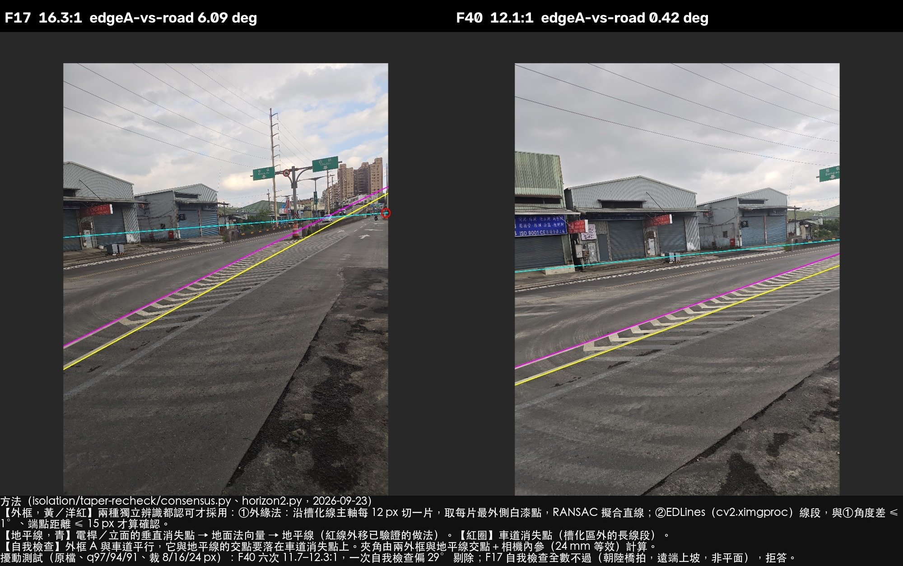
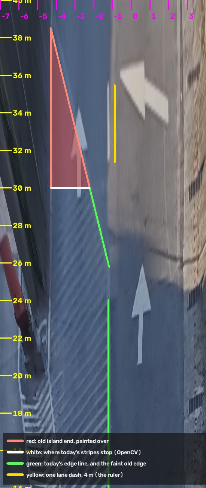
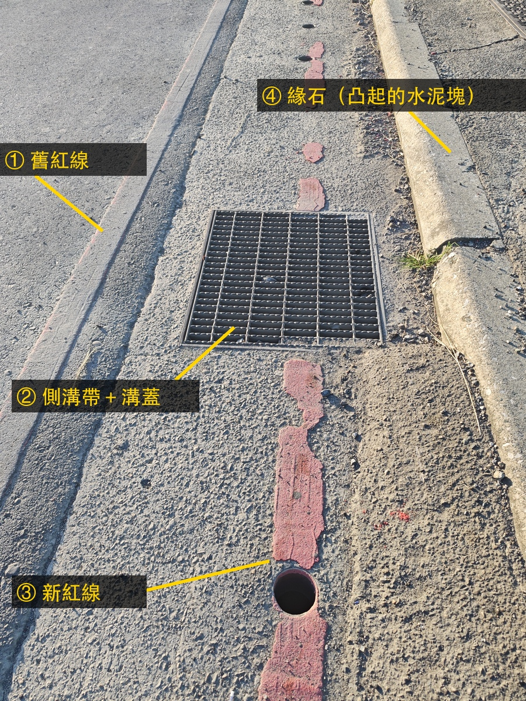
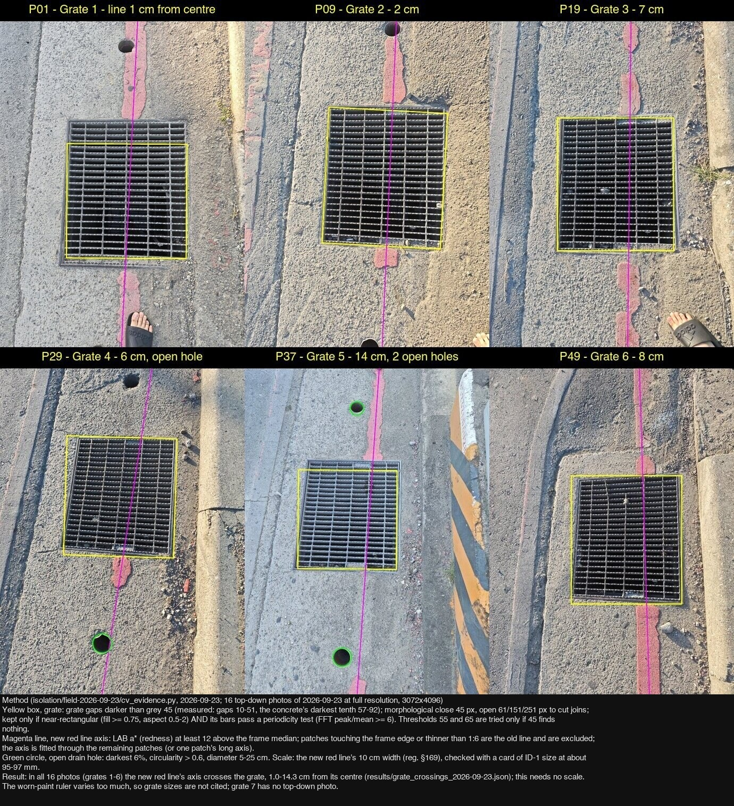

# What a rider meets on County Road 116 (Zhongzheng Road, Shulin)

Written in plain language. Each number is followed, in brackets, by its source file and uncertainty. This is not a judgement of who broke the rules. Which red line is the official one and which design speed applies are questions for documents; the ones to request are listed at the end.
Every figure produced by image recognition carries its method; the index is [`materials-2026-09-23.md`](materials-2026-09-23.md).

## The rider's complaint (in the rider's words, 22 September 2026)

> Before the island was painted over: you had to change lanes in a hurry, the lane shrank, and on a scooter you ended up riding the drain grates. **Seven of them.**
> After: the asphalt was dug out, and at night you can't see well. On the main road at night the view is poor, and right where the **asphalt dips** you meet **seven drain grates**, one after another.

Across the two periods, the constant is those seven grates. Before, the rider was pushed onto them by the rush to change lanes. After, the dug-out dip leads the rider onto them, at night, without being able to see.

## Timeline

| When | This stretch | Source |
|---|---|---|
| 6 May 2025 → 30 Sep 2026 | Road excavation permit **New Taipei Metro Works 1140874494** (utility relocation for the metro): asphalt, 750 m long, 3 m wide, 1.2 m deep | `results/excavation_live_2026-09-22.json` |
| Before 2026 | Earlier states of the road were seen on Street View. Google's terms do not allow sharing what was read from it, so they are not described here | — |
| By September 2026 | About two thirds of the island painted over where I measured it (64.8%; moving my hand-drawn edge 20 px gives 54.9–68.3%); the red line repainted further out, onto the drain strip | `results/before_taper.json`; the "Red line" section below |
| 20 Sep 2026 | I walked the stretch and took 42 photos (15:56–16:01) | `evidence/field-2026-09-20/MANIFEST.csv` |
| 23 Sep 2026 | 64 photos at dawn (06:30–06:34): top, front and side shots of the seven grates (grate 7 has no top-down shot) | `evidence/field-2026-09-23/README.md` |

## This stretch

**From the start of the solid line to the bridge.** During the works the whole stretch was limited to about 30 km/h (my observation). Distances along the road are not given: the ones I had came from Street View, which I cannot share.

- **First, a double white solid line: no changing lanes.**
- **Then the painted island, and the lane narrows.** The Urban Road Design Specification, table 4.2.7 ("through-lane shift"), asks for 5:1 at 30 km/h and 16:1 at 50 km/h for through-lane shifts at turning lanes; I use it only as a reference. (`docs/evidence.md` L19)

| | Taper | Against 5:1 at 30 km/h | Source |
|---|---|---|---|
| **Today** (20 Sep 2026, photo F40) | **about 12 : 1** (11.7–12.3) | gentler than the reference |  |
| **Near the cone** (23 Sep 2026, photo P64, top-down view) | **about 6 : 1** (outer edge at 9°, 8.5–9.4°) | just gentler than the reference |  |

- **The island opens more steeply near the cone, and its old end was painted over.** Seen from above (OpenCV turns my photo P64 into a top-down view with the lane dashes as the ruler), the stripes past the cone stop about 8.5 m short of where they used to end. The painted-over triangle is about 2.1 m wide at its base and about 9 m²; the left lane's arrow is painted on it. Its old slanted edge (about 14° to the road) is still faintly visible. OpenCV made the top-down view and found where today's stripes stop; I gave the dash centres, the old edge's two ends and the line its tip reaches. (`results/erased_triangle_P64.json`, about ±10%)

- **Withdrawn:** an earlier version said "about 10:1 (9.2–11.9)". That came from the program grouping different painted lines together, and could not be reproduced once the image was re-saved. The 9.2 was from F17, which looks up the bridge ramp where the ground is not flat, so plane geometry does not apply. (`isolation/taper-recheck/NOTES.md`)

## The red line: the old one was the real road edge

There are two red lines: (1) the **old red line**, worn, at the edge of the asphalt, and (3) the **new red line**, painted on (2) the drain strip and straight across the grates. They are **0.63–0.68 m** apart. (F30–F32 on 20 September, `results/redline_gap_F30.json`, `F31`, `F32`; median gap from the intact line's inner edge to the worn line's centre; top-down shots of 23 September were not verified to be square to the road and are not used. The ruler is the red line's own 10 cm width, checked with a card of ID-1 size at 95–97 mm.) (4) The kerb is further out, a raised concrete strip.

What the rules say. The Chinese text is the law (the national law database states that where the English and Chinese versions differ, the Chinese prevails); the originals, checked word for word, are in [`evidence.md`](evidence.md). The three clauses below have no official English version that I could find, so the translations are mine and **unofficial**:

- **Road Traffic Signs, Markings and Signals Rules §169:** a no-temporary-stopping line "is drawn, as a rule, on the front or top face of the **kerb**; on a road without a kerb it may be marked on the road surface, about 30 cm from the edge." (`docs/evidence.md` L2)
  Here there **is** a kerb, yet the new red line is not on it, and the drain strip it is painted on is not the asphalt surface either.
- **Same rules §183:** the road edge line "indicates the edge of the shoulder or the outer edge of the road surface … it may be omitted … where a no-stopping or no-temporary-stopping line is drawn." (L20)
  Where there is a red line, no white edge line is needed, so **the red line itself marks the road's outer edge**.
- **Urban Road and Ancillary Works Design Standard §2(1):** "A lane is the part of the road delimited **by markings** or by physical means …" (L21)
  Wherever the markings go, the lane goes.

**So** (this is my reading, not the text of the law): moving the red line out by about 0.65 m put the drain strip and its grates inside the "road". The asphalt a scooter can ride did not get any wider; only the lane on paper did. A rider who follows the markings rides onto the grates.

## The grates: the red line is painted right over them

- **Seven grates**, along the right-hand drain strip. On 23 September I photographed all seven, in order along the road by timestamp. (`evidence/field-2026-09-23/README.md`)
- **Image recognition:** in **all 16** top-down photos of 23 September (grates 1–6; grate 7 has no top-down photo), **the new red line's axis crosses the grate**, 1.0–14.3 cm from its centre. This result needs no scale. (`results/grate_crossings_2026-09-23.json`, from `isolation/field-2026-09-23/cv_evidence.py`)
- **Open holes:** beside grates 4 and 5 there are uncovered round drain holes, about 8–11 cm across, 4–13.5 cm from the red line's axis.

### Slippery when wet, and a step

- **Highway Act §72, paragraph 4**, in the **official English translation** (law.moj.gov.tw; the English page reflects the 19 December 2025 amendment, the Chinese text in force was amended 17 August 2026 and prevails): "Where piping or wiring agencies or other engineering authorities (agencies) use highway land to install pipelines, manholes, or handhole covers, they shall restore and properly backfill the area after installation or maintenance to be **flush with the adjacent road surface**. The **anti-skid value** standards for surface facilities such as manhole or handhole covers shall not be lower than the standards set by the MOTC. Furthermore, within the warranty period after backfilling as determined by the highway authority, the road surface smoothness shall be tested using a **three-meter straightedge**, and the single-point elevation difference shall **not exceed ±0.6 cm**." (L22) The ministry's skid-resistance standard is **50 BPN** for covers of at least 900 cm² that are not sunk below the surface. (Highway Land Use Rules §14-1, as reported by the Central News Agency on 20 June 2026; the rule's text was not retrieved.)
- **New Taipei road excavation review rules 6.0:** new-to-old pavement joints, a single-point step measured with a 3 m straightedge within ±0.6 cm. (`docs/source-ntpc-excavation-6.0.txt`)
- Both rules are about the same thing: covers must sit flush and must not be slippery. News coverage of the amendment framed it around scooters skidding and falling in the rain. (Central News Agency, 2 December 2025 and 20 June 2026; the legislative reasons were not retrieved.)
- **What I did not measure:** how slippery the grates are when wet and how far below the road they sit. Photos cannot tell; the step needs a 3 m straightedge on site and the grip needs a pendulum skid tester. Whether §72 covers drain grates, and whether this stretch is governed by the Highway Act or by urban-road rules, has not been confirmed.
- **What you can see:** in the side shots, along the joint between the asphalt and the drain strip there is a groove running with the road: the "asphalt dip" in the rider's words. (Side shots P14–P18 and P25–P27, grates 2 and 3, 23 September)

## Low sun in the morning, and night

- **Glare:** on winter mornings the low sun can be in your eyes heading to the bridge (my experience). The hours I had computed used a road bearing read from Street View, so I do not give them.
- **Night:** the rider reports poor visibility. There are no night photos yet, and no street-lighting data.

## On a scooter here

The right is closed (red line, grates, open holes). The left cannot be crossed on the solid stretch (§167, no-lane-change line, `evidence.md` L1). The only place to move left is the island stretch.

**The risk is after the merge.** Past the island the right lane is painted to merge left, so everyone ends up in one lane. Measured in P64's top-down view, that lane is about **3.1 m** wide. A car, 0.5 m of clearance and a scooter need 3.03 m: about 0.1 m to spare, inside the error. Next to a bus or truck it is about 0.6 m short. (That 3.03 m is a sum I made, using §101's 0.5 m; it is not a lane-width rule. `results/erased_triangle_P64.json`, `results/width_budget.json`.) The right lane before the merge is about 4.05 m to the edge of the asphalt, and beyond that are the grates. During the works the limit was about 30 km/h (my observation). In my experience, scooters and cars compete for the same lane at the merge. In rain, with poor visibility, or at night it is worse; that is my experience, not a measurement.

## Stacked together

Each one, on its own, sits at the edge of a limit:

1. **Left:** the solid line can't be crossed, and there is little room left to merge.
2. **Right:** the red line moved out about 0.65 m and put seven grates and open drain holes inside the "road". §169 puts a red line on the kerb, §183 makes the red line the road's outer edge, and Design Standard §2 says the lane goes where the markings go.
3. **Underfoot:** Highway Act §72 asks for covers restored flush and not slippery; whether these grates are has never been measured, and whether its ±0.6 cm limit applies to them is not established.
4. **Beside:** metro utility works, a 750 m permit.
5. **Time of day:** on winter commuting mornings, the low sun ahead; at night, poor visibility.

But all of it lands on the same stretch and the same rider: no crossing on the left, grates on the right, the lane narrowing in the middle, and the sun in your eyes. **I am not claiming a single rule is broken here. The design stacks several things to avoid onto the same stretch of road.**

## What I can't do, or haven't done

- The step and the wet grip of the grates: photos cannot measure them; they need a 3 m straightedge and a pendulum tester on site.
- Night: no photos.
- The taper before painting over: not established.
- Grate sizes: with the worn red line as a ruler the readings disagree widely, so they are not cited.
- Illegal parking: visible in photos, not counted.
- Effective lane width (how much a scooter can actually use): no number yet.

## Documents to request

1. New Taipei City Traffic Department: the **approved marking-change letter and marking drawings** for County Road 116, Zhongzheng Road (Shulin section), to settle which red line is official and where the solid line is meant to start.
2. New Taipei City Government (Department of Rapid Transit Systems / Public Works): the **traffic management plan and construction drawings** for permit 1140874494, to settle the design speed and whether the drainage works extend to this stretch.
3. Shulin District Office, Public Works Section: the **as-built drawings of the drain works and the cover test reports**, for the covers' specification, skid resistance and step against the road.
4. The responsible authority: whether this stretch is governed by the **Highway Act** or by **urban-road** rules, which decides whether Highway Act §72 applies.

(Legal basis: the Freedom of Government Information Act.)

> 2026-10-13: the before-repainting taper measured on Google Street View was withdrawn from this story. Google's terms do not allow sharing data derived from Street View.
